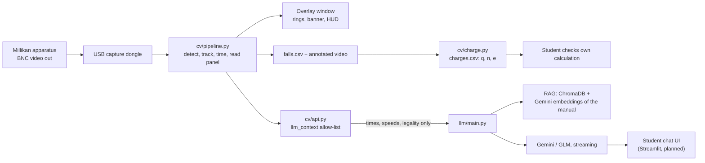
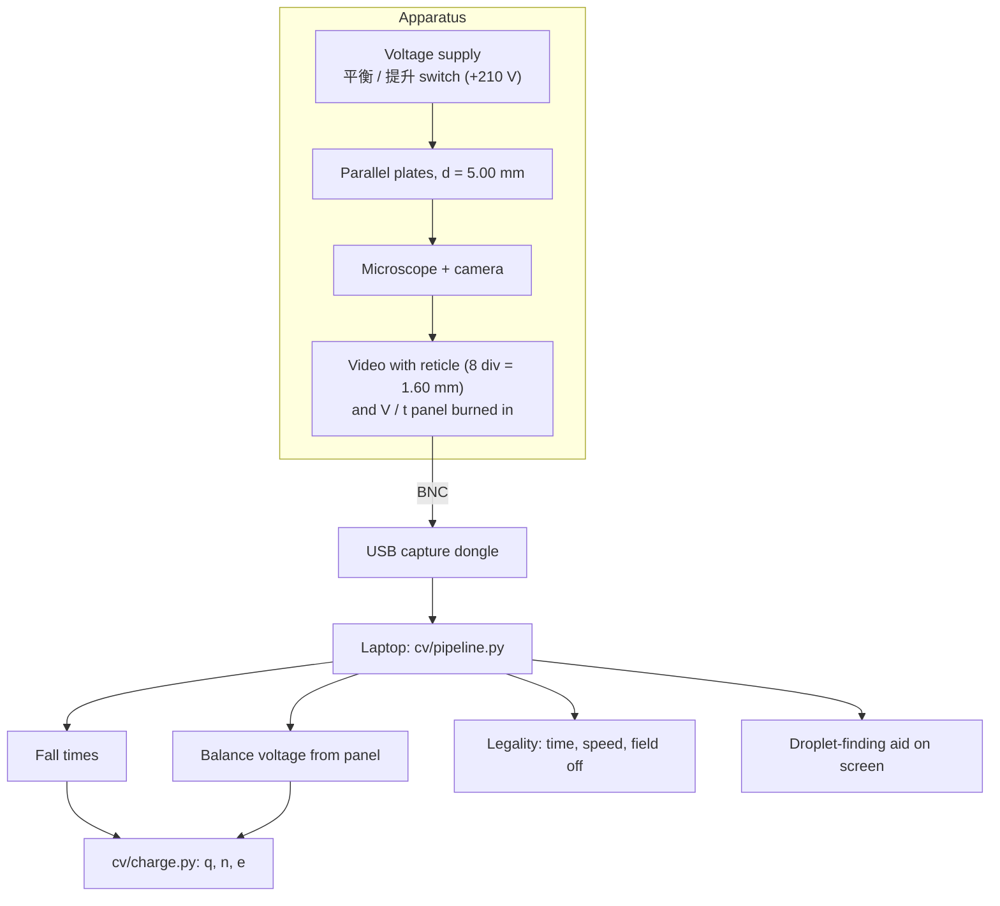

# CV hand-over for the report — chapters 5–8

Answers `Requirements_from_report.md`. Every number comes from the recordings or the
repo; anything not yet measured says so. Supporting files in this folder: `HUNT_TIMES.md`,
`BENCHMARK.md`, `ALGORITHMS.md`, `WHY_CLASSICAL_CV.md`, `charges_all.csv`, `falls_*.csv`,
`circularity_sweep.txt`.

**Two facts before writing chapter 5:**
- `app/` holds only a README. Streamlit is listed in `requirements.txt`, but **no web UI
  code exists yet**. The interface in real use is the pipeline's OpenCV overlay window.
- The tutor currently reads **placeholder** CV data (`cv.api.sample()`). The connection
  contract exists; feeding it live output is the remaining step.

---

## Chapter 5 — CV model and app development

### 5.1 Algorithms and methods per system

No trained model. Classical computer vision plus rules taken from the lab manual.
`mag` = image scale factor, 0.85 on this apparatus (61 px per grid division).

**Detection** (frame → droplet candidates)

| method | purpose | setting |
|---|---|---|
| Rolling median background | learn what is static: grid, labels, panel | 61 samples over 300 s, rebuilt every 5 s, 30 s initial learn; sample interval kept off whole seconds |
| Stale-background rebuild | recover after the focus is touched | detections ≥ 4× the session's quiet rate for 45 s |
| Background subtraction (absolute difference) | isolate what moves | — |
| Gaussian blur | suppress pixel noise | — |
| Otsu's threshold + noise floor from median absolute deviation | per-frame threshold that cannot collapse on an empty chamber | floor factor 6 |
| Morphological opening / closing | remove specks, fill droplet blobs | — |
| Top-hat transform | find reticle lines and panel text | — |
| Connected-component labelling | mask static glyphs (`0`, `1.6`, `V:`) | masks 0.41% of the frame |
| Suzuki–Abe contour tracing | outline each blob | — |
| Image moments | blob centre | — |
| Circularity 4πA/P² | reject streaks, clumps, grid flares | ≥ 0.52 |
| Area cap | reject flares | ≤ 900·mag² px² (655 px²) |
| Exclusion bands | ignore grid rows, image edge, panel margin | grid ±4·mag, edge 20·mag, panel 40·mag px |

**Tracking — many droplets at once**

| method | purpose | setting |
|---|---|---|
| Constant-velocity motion model | predict each droplet's next position | — |
| Distance gating | discard impossible pairings | ≤ 12·mag px between frames |
| Hungarian algorithm (`scipy.optimize.linear_sum_assignment`) | optimal blob↔track matching, whole frame at once | — |
| Priority pass | the droplet being timed claims blobs first | — |
| Track confirmation | kill one-frame strays | 6 sightings; unconfirmed track dies after 0.2 s |
| Duplicate-spawn guard | stop twin tracks on one droplet | 14·mag px |
| Coasting | survive blackouts on grid lines | 3 s; 6 s while timing |
| Re-acquisition ("morgue") | revive a recently lost track | within 6 s; x ±14·mag px, y ±60% of predicted drop, area ±70% |
| Position binding | group one droplet's falls without relying on track ids | same column ±60 px, fall times within 5% |
| Crossing adoption | recover a fall whose track broke part-way | track covers ≥ 35% of the fall, every point ≤ 6 px off the line |

**Tracking — timing**

| method | purpose | setting |
|---|---|---|
| Line-crossing interpolation on capture timestamps | fall time independent of frame rate | sub-frame; timestamp taken between `grab()` and `retrieve()` |
| Least-squares line fit + residual | speed, and "is this a straight fall, not stitched noise" | residual ≤ 3 px over 3 s |
| Kinematic legality (manual Ⅳ.2) | accept a fall | 8 divisions = 1.60 mm, 16–40 s, 0.2–0.5 div/s |
| Field-off check | fall must happen at 0 V | panel digits all alike, sampled on 15 frames per fall |
| Rise void | cancel a run when the droplet is lifted | 0.5 division of upward travel |
| One-division test | judge a droplet before a full fall | 2–5 s per division |

**Voltage reading** (from the apparatus panel in the video)

| method | purpose | setting |
|---|---|---|
| Glyph segmentation + 4-step dynamic programming | locate the four unevenly spaced digits | uneven gaps of 42 / 39 / 44 px |
| Template matching, zero-mean normalised cross-correlation | identify each digit | two template sets (latched line, live `V:` line) cut from labelled sweeps of 24 held voltages |
| Multi-frame median after re-alignment | stable read | single-frame alignment read 733 for 133; stale alignment 183 for 83 |
| Agreement vote | refuse a misread instead of guessing | ≥ 90% of frames must agree, else no value |
| Lift detector (rate test) | tell the 提升 switch (+210 V) from a hand on the knob | median of 5 readings; ≥ 150 V within 0.5 s |
| Live-line fallback | voltage when the latched line shows +0000V | last live reading, kept 120 s |

**Processing**

| method | purpose |
|---|---|
| Stokes radius, manual eq. (1-13) | droplet radius from fall speed |
| Static-method charge, eq. (1-14), with the b/(p·a) correction | charge q |
| n = round(q/e), e_i = q/n (manual Ⅵ.2) | electron count, elementary charge |
| Mean, sample SD, Type A / Type B uncertainty | per-droplet and overall results |
| Integer-distance check | live warning when q/e is more than 0.20 from a whole number |
| Balance estimate U_b = U / (1 − v/v_free), v_free measured at 0 V | suggest voltage direction; hide droplets the supply cannot balance |
| Three-way charge test (responds / does not / unknown) | skip droplets that ignore the field: ≥ 0.10 div/s speed change after a ≥ 50 V step, 0.5 s settling |

### 5.2 App and AI — frameworks and libraries

| layer | in the repo |
|---|---|
| Language | Python 3.11.9 |
| CV | OpenCV 5.0.0, NumPy 2.4.6, SciPy 1.17.1, pandas 3.0.5 |
| Chat models | Google Gemini `gemini-3.1-flash-lite` (google-genai SDK); Z.ai `glm-5.2` (OpenAI Python client). Streaming, temperature 0.7 |
| Retrieval (RAG) | Gemini `gemini-embedding-001` (768-d vectors) → ChromaDB; lab manual loaded with pypdf and LangChain loaders / text splitters |
| Back end (`llm/`) | provider base class → Gemini / GLM; streaming via worker thread + queue; timeout wrapper; input limit 2,000 chars; memory of 20 messages per session; logger; system-prompt builder (1,072 lines) |
| Config | python-dotenv (API keys) |
| Web UI | Streamlit — **listed, not built** |
| Operator UI (built) | OpenCV window: candidate rings, instruction banner, HUD (tracked, falls, legal, voltage, hunt time), click-to-select, ✗ on uncharged droplets |
| Listed, unused | `anthropic` (not imported anywhere) |

### 5.3 How the two systems connect

One entry point: **`cv/api.py`** — `survey()`, `analyze()`, `sample()`, `llm_context()`.

- `llm_context()` passes an **allow-list** only (`LLM_KEYS`): per fall — time, speed,
  legality, field-off, drift; per droplet — label, fall count; per session — progress
  and health.
- **q, n, e and the balance voltage never cross.** Rubric 三.1.4: the AI must not do the
  student's analysis. The tutor has the manual in retrieval, so fall time + voltage
  would already be the answer.
- Today `llm/main.py → getSafeDropletData()` puts `llm_context(sample())` into memory.
  Next step: live `analyze()` output in place of `sample()`.

### 5.4 Methods tried or considered, and why they lost

| tried or considered | what happened | chosen instead |
|---|---|---|
| Trained detector (CNN) — considered | needs labelled footage per lamp, focus and camera; cannot explain why it rejected something (`WHY_CLASSICAL_CV.md`) | classical pipeline, each threshold measured |
| Greedy nearest-neighbour matching — considered | can swap identities of two close droplets | Hungarian assignment |
| Circularity ≥ 0.80 | droplets seen in 77% of frames; a perfect 2–5 px disc scores only 0.67–0.79 | 0.52; re-run at 0.48 and 0.45 on 56,547 frames → no extra falls |
| Area cap 100·mag² | 1 of 15 hand-timed falls found | 900·mag² → 15 of 15 |
| Adaptive per-session area cap | deferred, not needed at this magnification | fixed cap |
| Timing by frame count | camera says 30 fps, delivers 22.4–23.6 | capture timestamps |
| Corroboration gate (new track only on a blob also seen last frame) | removed 87% of noise, but operator falls 5 → 3 | not used |
| Focus change from frame–background disagreement | 0.31% / 0.39% / 0.41% in handling / spray / quiet — no separation | detect the symptom: detection rate |
| Focus change from reticle sharpness | impossible: the reticle is drawn electronically | same |
| Background sampled every 1.000 s | 13 traverses, 0 legal vs 37 and 2 at 1.067 s | interval kept off whole seconds |
| Grouping falls by track id | 9 falls came from 7 track ids on one live session | position + duration binding |
| Rigid digit comb / scoring every x / stretching glyphs / aligning from `V:` | clipped digits; false chains; every `1` read as `7`; 609 V and 749 V | segmentation + dynamic programming; latched line aligns itself |
| Better matcher for `2` misread as `7` | still read `0700` with cut and binarised variants | multi-frame vote, refuse below 90%, more templates |
| H.264 clips as the acceptance gate | compression blur lets blobs pass that raw frames do not | raw frame captures gate; clips advisory |
| Lift = a large voltage change | a hand turn and the switch both change the voltage | rate: hand ≤ 80 V/s (3 V per reading); switch 210 V in one reading (12 of 12 presses); OCR glitch up to 844 V → median, then rate |
| Fixed free-fall speed 0.35 div/s | at 150 V a droplet falling 0.27 div/s computed as 656 V (unreachable); with v_free 0.45 it is 375 V | v_free measured at 0 V |
| Fixed drift gate 0.10 div/s | at 250 V only balances ≤ 350 V were shown; the supply reaches ≥ 459 V | gate from reachable balance voltage |
| "Chosen droplet" = running fall clock or a legal fall | aid pinned itself to stray droplets | droplet held on `0` for 15 s, or clicked |
| Single-threshold charge test | crossed out droplets that did respond | three answers + 0.5 s settling |
| Voltage from latched line only | 12 of 35 legal falls had no voltage (09-10 lab sessions) | live `V:` line fallback |
| Adoption needing ≥ 50% coverage | the real lost fall had 38% | ≥ 35% + ≤ 6 px residual |
| Drop the annotated video to gain frame rate | writer costs 10.9 ms/frame, but it is the only record of a live run | kept |
| Refresh the window every 3rd frame | saves the 14.1 ms of `waitKey`, but on Windows gives an 8 fps picture | every frame |

---

## Chapter 6 — Development history

### 6.1 Timeline (57 commits, 2026-08-12 → 09-11)

| date | what changed | why | result |
|---|---|---|---|
| 08-12 | CV stub API; LLM back end + retrieval | tutor work could start before CV existed | CV and tutor built in parallel |
| 08-27 | CV API v2: session → droplets → falls, legality flags, LLM allow-list | v1 held one result per video, not 5 falls per droplet | one data shape; charge kept away from the tutor |
| 08-28 | pipeline moved into `cv/`, `api.py` the only entry; dongle check tool | code was reachable from many places | one entry point to test and seal |
| 08-29 | lost-track recovery: area floor, no duplicate spawn, re-acquisition | droplets blink out mid-fall; twin tracks on one droplet | fewer lost falls and duplicates |
| 08-30 | timing on capture timestamps | camera says 30 fps, delivers 22.4–23.6 | fall times independent of frame rate |
| 09-02 | panel and grid read at the dongle's geometry | positions had been measured on monitor recordings | panel and grid found on dongle video |
| 09-03 | live path on real hardware (7 fixes at the bench); blind benchmark mode | first run at the lab | live measuring works; human-vs-pipeline test possible |
| 09-06 | charge maths inside the CV layer; real grid-line masks; lossless frame replay | rubric 三.1.4; grid lines made false blobs; compressed video hides droplets | q, n, e computed but sealed; fewer false blobs; exact re-runs |
| 09-07 | balance voltage read from the panel; falls grouped by droplet; stale background rebuilt | voltage was typed in by hand; a refocus flooded the screen with false detections | voltage and grouping automatic |
| 09-08 | overlay decluttered; killed captures replayable; hand-timed session recorded | markers flickered on 2-frame noise; a killed capture lost its data | cleaner screen; 15 stopwatch falls as a reference |
| 09-09 | area cap 100 → 900·mag²; first aided hunt; LLM model config + session flow | pipeline found only 1 of 15 stopwatch falls | 15 of 15; first aided hunt 319 s |
| 09-10 | hunt aid, position binding, live panel reading; shape-gate sweep; `llm/` merged; lift detector; fall recovery; click-to-select | hunting took 81% of lab time; operator reports from live tests | aided hunt median 219 s vs 463 s unaided; 11 droplets, 55 falls |
| 09-11 | field state decides the verdict; live-line voltage; recovery threshold | wrong verdict at 0 V; 12 of 35 falls lacked a voltage; recovery refused the real lost fall | offline checks pass; live test pending |

### 6.2 Growth record (the "training log" equivalent)

No training epochs. Each change was replayed on the same fixed recordings and scored.
Two recordings served as benchmarks:
- **Hand-timed session** (09-08): 3 droplets, 15 stopwatch-timed falls, 56,547 lossless frames.
- **Acceptance recording** (older, one droplet): 5 operator-timed falls; every code change
  had to keep all five.

**Hand-timed session**

| version | stopwatch falls found | legal |
|---|---|---|
| area cap 100·mag² | 1 / 15 | — |
| area cap 900·mag² (09-09) | 15 / 15 | 15 / 15 |
| shape gate 0.52 / 0.48 / 0.45 (09-10) | 15 / 15 each; 260 / 261 / 259 traverses | 15 / 15 |

**Acceptance recording**

| version | traverses | speed-and-time legal | operator falls kept |
|---|---|---|---|
| before 09-09 | 33 | 7 | 5 / 5 |
| area cap 100 → 900·mag² (09-09) | — | — | 3 / 5 |
| + timed track claims blobs first, 6 s coast (09-09) | 46 | 16 | 5 / 5 |
| + panel-margin and glyph masks (09-10) | 43 | 16 | 5 / 5 |
| + rising droplets keep their track (09-10, current) | 46 | not recorded | 5 / 5 |

**Other measured steps**

| change | before → after |
|---|---|
| shape gate (circularity) 0.80 → 0.52 | droplet seen in 77% → 100% of frames (706 frames); 3.7 → 14.2 detections/frame |
| coasting 0.5 → 3.0 s | both legal falls on a test clip lost → both recovered |
| duplicate-spawn guard | 31% of new tracks had been twins within 12 px of a live track |
| background sampling 1.000 → 1.067 s | 13 → 37 traverses, 0 → 2 legal falls |
| panel vote gate 0.9 | 15 falls: 14 correct, 1 refused, 0 wrong |

**Droplets measured (cumulative):** 5 by 09-08 → 8 by 09-09 → **11** by 09-10 (55 falls).

### 6.3 Bugs and how they were found and fixed

| bug | symptom | cause | fix |
|---|---|---|---|
| Shape gate unreachable | droplet seen in 77% of frames, never > 2.6 s → no falls timed | small-blob bias in 4πA/P² | gate 0.80 → 0.52 |
| Area cap too tight | 1 / 15 falls | halo size depends on focus | 900·mag² |
| Stale background after refocus | 68,609 track ids in 10 min (healthy session: 2,362) | background held two scenes | rebuild when detections stay 4× the quiet rate |
| Frozen fall clock | first duration held through five drops; five identical rows | end time never cleared; the same record saved five times | clear it; save a copy per fall |
| Stale start after a lift | a 75.78 s "fall" | upward test needed the droplet seen above a height | test the direction of travel |
| Starved droplet | 2 falls lost on the acceptance recording | spawn reservation ignored area | reserve by position and area |
| `2` read as `7` | 700 V reported for a 200 V droplet | near-identical glyphs | vote across frames; refuse when frames disagree |
| Results written only at the end | 3 sessions lost in one day | CSV written after the last frame | write + flush per fall |
| Display hid a timed fall | operator re-dropped a droplet already being timed, ~20 s lost | draw filter ran before the "being timed" exemption | reorder |
| Hunt-time counting | a 2035 s hunt | a 4-fall droplet dropped, its time absorbed by the next | count droplets from 2 falls |
| Lift read as balance | "BALANCED at 459 V" advice; charge would be ~2× off | no lift awareness | rate-based lift detector |
| Nothing ringed at 150 V | aid silent at low voltage | fixed free-fall speed | measure it at 0 V |
| Rising droplet lost its track | new track id after each lift | re-acquisition was falling-only | mirror by direction |
| Aid pinned to strays | aid went silent | chosen droplet guessed from clock / legal fall | 15 s hold on `0`, or click |
| False "uncharged" | responsive droplets crossed out | one threshold, unsettled samples | three-way test + settling |
| "3/5" shown at 5/5 | wrong progress | count method differed from grouping | count the way grouping does |
| Wrong verdict at 0 V | falling droplet called "no reaction" | charge question asked before field state | field state first |
| Missing voltage | 12 / 35 legal falls without U | latched line shows +0000V | fall back to the live `V:` line |
| Fall-recovery threshold | would refuse the real lost fall (38% tracked) | 50% was a guess | 35% + unit test |

How they were found: replaying against stopwatch times (area cap, shape gate), the
acceptance recording (starved droplet, rising tracks), frame-by-frame review of the
annotated video (hidden fall), and operator reports during live tests (aid bugs).

### 6.4 AI tutor and app

**To be written from the LLM / app teammates' records** (prompt iterations, model
comparisons, test conversations, UI design). What the shared code shows so far:

- No training or fine-tuning: hosted models via API, grounded by retrieval over the lab
  manual.
- Built: Gemini and GLM behind one interface, streaming, timeout, input limit,
  20-message memory, manual indexed in ChromaDB, system-prompt builder.
- Web UI not built yet.

### 6.5 Integration record

| date | problem | solution |
|---|---|---|
| 08-12 | LLM side needed CV data before CV existed | stub API with sample data |
| 08-27 | one dict per video could not hold 5 falls per droplet; field names inconsistent | v2: session → droplets → falls; allow-list for the LLM |
| 08-28 | pipeline code reachable from many places | `cv/api.py` the only entry point |
| 09-06 | tutor + manual + time + voltage = the student's answer | q, n, e, U computed inside CV and never put in the LLM dict |
| 09-10 | CV and `llm/` code diverged | merged |
| to do | tutor reads `sample()` | pass live `analyze()` output |

---

## Chapter 7 — Methodology

### 7.1 Preparation: traditional vs CV-integrated

| step | traditional | CV-integrated |
|---|---|---|
| Setup | level the platform (Ⅳ.1), focus, lamp | same + BNC video into USB dongle, start pipeline, 30 s background learn before spraying |
| Find a droplet | by eye, 0.2–0.5 div/s (Ⅳ.2) | aid rings candidates, marks uncharged ones ✗, operator clicks one |
| Balance | adjust voltage by eye (Ⅳ.3) | same, with suggested direction and "balanced" message |
| Time 5 falls | stopwatch over 1.60 mm (Ⅳ.4) | automatic from line crossings |
| Record voltage | read panel | read from video |
| Calculate | by hand | `charges.csv` + live integer check |

### 7.2 Apparatus + CV

The apparatus is not modified. CV only reads its video output.

### 7.3 Real-time performance and equipment

All results in this document were measured on this one machine.

| item | spec |
|---|---|
| Laptop | ASUS Vivobook S 15 (S5507QA) |
| CPU | Qualcomm Snapdragon X Elite X1E78100, 12 cores, ARM64 |
| RAM / GPU | 31.6 GB / Adreno X1-85 (GPU not used) |
| OS | Windows 11 Home, ARM64 |
| Video input | apparatus BNC → USB UVC capture dongle, 1280×720; advertises 30 fps, **delivers 22.4–23.6 fps** |
| Software | Python 3.11.9, OpenCV 5.0.0, NumPy 2.4.6, SciPy 1.17.1, pandas 3.0.5 |

**Latency** (3,000 frames of the 09-08 recording, everything else equal)

| configuration | per frame | frame rate |
|---|---|---|
| without annotated-video writer | 30.3 ms | 33.0 fps |
| with writer (normal live use) | 41.2 ms | 24.3 fps |

- Writer 10.9 ms/frame; track assignment ~15% and panel reading ~22% of the rest.
- `cv2.waitKey(1)` (window refresh) takes 14.1 ms of the 42.4 ms frame budget on Windows.
- Live: ~22.3 fps effective; 1,888–4,253 frames dropped per run.

**Why dropped frames do not bias results:** crossings are interpolated on capture
timestamps, so each is located to ~22 ms — **0.1%** of a 20 s fall.

### 7.4–7.6 Components

| component | role |
|---|---|
| Millikan apparatus | plates d = 5.00 mm; reticle 8 div = 1.60 mm; supply with 平衡/提升 switch; BNC video out |
| USB UVC capture dongle | video into the laptop |
| Laptop (7.3) | runs everything |
| `cv/UVC_check.py` | bench check: finds the grid, names the device to open |
| `cv/pipeline.py` | capture (camera / file / raw-frame replay), detection, tracking, timing, panel reading, droplet-finding aid, binding |
| `cv/charge.py` | eq. (1-13), (1-14), manual constants |
| `cv/api.py` | contract to the tutor, charge seal |
| `llm/` | tutor back end |
| Development test scripts | automated checks used while building: benchmark replays, regression gate, hunt timing, unit tests. Not part of the finished product |

### 7.7 Validation and verification

**In place**

| check | how | result | when it runs |
|---|---|---|---|
| Timing vs stopwatch | 09-08 session replayed; each of the 15 stopwatch falls compared with the pipeline's fall at the same moment | mean −0.11 s, sd 0.23 s, mean abs 0.19 s | on demand, automatic |
| Timing vs operator | older one-droplet recording, 5 operator-timed falls, paired shortest with shortest | mean −0.27 s, sd 0.42 s | every code change, automatic |
| Result vs stopwatch | e from hand times vs pipeline times, droplets 1–3 | within 0.9 percentage points (8.2) | once, automatic |
| Fall detection | the same two recordings | 15 / 15 and 5 / 5 | as above |
| Regression gate | lossless recordings replayed; every operator-timed fall must survive and the fall count must stay ≥ 95% of the last accepted run | 12+ runs, all passed | every code change, automatic |
| Hard-case clips | 4 compressed clips with glare, tilt, blur and blackouts; 20 known falls | reported, not gating; one clip keeps 8 / 10, both losses checked and genuine | every code change, automatic |
| Shape-gate sweep | 3 full runs of the 09-08 session at circularity 0.52 / 0.48 / 0.45 | 15 / 15 each, same durations | once, automatic |
| Fall-recovery unit test | geometry of a real lost fall; 4 cases that should be recovered, 4 impostors | all 8 correct | on demand, automatic |
| Panel reading | 15 falls of the 09-08 session vs the known voltages | 14 correct, 1 refused, 0 wrong | once, automatic |
| Physics self-check | q/e distance from a whole number | warns above 0.20 | live, every fall |
| Accepted value | e vs 1.602×10⁻¹⁹ C | −3.13% over 55 falls | per result set, automatic |

**Per-frame detection accuracy (asked for in chapter 8) — done, results in 8.5**

- 150 frames sampled at random from the 09-08 recording across its four phases (30 spray,
  50 hunting, 50 measuring, 20 quiet), plus 15 of them shown again without notice.
- One person marked every droplet (66 min), blind: the pipeline's output, the frame
  number and the phase were hidden. Faint or ambiguous dots could be marked "unsure",
  which counts neither way.
- Scored at three stages: raw detector blobs, tracked droplets (the screen's "tracked"
  count) and the rings shown to the operator. A detection within 8 px (about one droplet
  width) of a mark is a hit. Phases weighted by their share of session time; 95%
  bootstrap intervals.
- Blind second look at every spot where the marks and the tracker disagreed (459 spots),
  without showing which side made the call.
- Control for that second look: 40 empty spots and 40 real droplets mixed in, blind.

**Not done yet (asked for in 7.3)**

- **Second laptop.** Replaying the 09-08 recording on another laptop needs no apparatus
  and gives ms/frame and whether all 15 falls come out the same. A live run needs the
  dongle on that laptop at the lab.

---

## Chapter 8 — Results

### 8.1 Per droplet, with Type A and Type B uncertainty

Static method (manual Ⅳ.4): falling times only. The dynamic (rising) method was not run,
so there are no rising times. Constants from manual Ⅴ: l = 1.60 mm, d = 5.00 mm,
ρ = 981 kg/m³, g = 9.78 m/s², η = 1.83×10⁻⁵ Pa·s, b = 8.22×10⁻³ m·Pa, p = 1.0098×10⁵ Pa.

- Type A: u_A = s/√5 over the droplet's 5 falls.
- Type B: u_B(t) = √2·Δt/√3 = **36.6 ms** (Δt = 44.8 ms frame interval, two crossings);
  u_B(U) = 1 V/√3 = **0.58 V** (±1 V assumed supply wander).
  With q ∝ t^−3/2·U^−1: u_B(e)/e = √[(1.5·u_B(t)/t)² + (u_B(U)/U)²].
- u_c = √(u_A² + u_B²).

| droplet | U (V) | mean t (s) | u_A(t) (s) | n | e (×10⁻¹⁹ C) | u_A(e) (C) | u_B(e) (C) | u_c(e) (C) | u_c rel | error vs e |
|---|---|---|---|---|---|---|---|---|---|---|
| 1 | 151 | 31.10 | 0.218 | 2 | 1.6421 | 1.81e-21 | 6.9e-22 | 1.94e-21 | 1.2% | +2.50% |
| 2 | 176 | 29.23 | 0.146 | 2 | 1.5536 | 1.22e-21 | 5.9e-22 | 1.35e-21 | 0.9% | −3.02% |
| 3 | 200 | 27.90 | 0.095 | 2 | 1.4718 | 7.90e-22 | 5.1e-22 | 9.43e-22 | 0.6% | −8.13% |
| 4 | 265 | 17.42 | 0.096 | 3 | 1.5515 | 1.33e-21 | 6.0e-22 | 1.46e-21 | 0.9% | −3.15% |
| 5 | 233 | 36.67 | 0.517 | 1 | 1.6417 | 3.73e-21 | 4.8e-22 | 3.76e-21 | 2.3% | +2.48% |
| 6 | 150 | 32.99 | 0.372 | 2 | 1.5067 | 2.66e-21 | 6.3e-22 | 2.73e-21 | 1.8% | −5.95% |
| 7 | 250 | 36.31 | 0.264 | 1 | 1.5525 | 1.78e-21 | 4.3e-22 | 1.83e-21 | 1.2% | −3.09% |
| 8 | 210 | 20.31 | 0.166 | 3 | 1.5397 | 1.96e-21 | 5.9e-22 | 2.05e-21 | 1.3% | −3.89% |
| 9 | 219 | 36.86 | 0.212 | 1 | 1.7300 | 1.58e-21 | 5.2e-22 | 1.66e-21 | 1.0% | +7.99% |
| 10 | 140 | 27.34 | 0.094 | 3 | 1.4469 | 7.77e-22 | 6.6e-22 | 1.02e-21 | 0.7% | −9.68% |
| 11 | 271 | 36.28 | 0.198 | 1 | 1.4336 | 1.26e-21 | 3.8e-22 | 1.31e-21 | 0.9% | −10.51% |

**All 55 falls:** e = 1.5518×10⁻¹⁹ C, sd 9.5×10⁻²¹ C, u_A(mean) 1.3×10⁻²¹ C,
**error −3.13%**. Electron counts observed: **1, 2, 3**. Per-fall radius, q, n, e_i:
`charges_all.csv`.

Notes:
- Within a droplet, falls scatter 1.2–5.1% and u_c is 0.6–2.3%. Between droplets the
  error spreads with sd 5.6%. So most of the error is fixed per droplet, not timing or
  voltage resolution. Balance voltage, fall time and n do not predict it (|r| ≤ 0.36,
  `BENCHMARK.md`). For scale: a droplet still drifting 0.02 div/s when judged balanced
  shifts q by 0.02/v_free = 4–10%, the size of the spread. Drift at balance was not
  logged.
- Droplet 4 fall 5 (17.49 s) was measured from the session recording after the live
  tracker lost the track mid-fall (`README.md`).

### 8.2 Machine vs manual

**Per fall** (09-08 hand-timed session; hand = operator's stopwatch)

| fall | hand (s) | pipeline (s) | diff (s) | U (V) |
|---|---|---|---|---|
| D1 f1 | 30.57 | 30.58 | +0.01 | 151 |
| D1 f2 | 31.75 | 31.39 | −0.36 | 151 |
| D1 f3 | 30.80 | 30.77 | −0.03 | 151 |
| D1 f4 | 31.83 | 31.79 | −0.04 | 151 |
| D1 f5 | 31.43 | 30.99 | −0.44 | 151 |
| D2 f1 | 29.20 | 29.15 | −0.05 | 176 |
| D2 f2 | 29.57 | 29.33 | −0.24 | 176 |
| D2 f3 | 29.37 | 28.88 | −0.49 | 176 |
| D2 f4 | 29.42 | 29.07 | −0.35 | 176 |
| D2 f5 | 29.47 | 29.74 | +0.27 | 176 |
| D3 f1 | 28.03 | 28.09 | +0.06 | 200 |
| D3 f2 | 27.85 | 27.63 | −0.22 | 200 |
| D3 f3 | 27.82 | 27.89 | +0.07 | 200\* |
| D3 f4 | 27.58 | 27.75 | +0.17 | 200 |
| D3 f5 | 28.20 | 28.12 | −0.08 | 200 |

\* The panel showed +0000V during this fall: an apparatus display fault (a jammed button).
The voltage was recovered by majority vote over the droplet's other four falls, all 200 V.

15 / 15 found; mean −0.11 s, sd 0.23 s. A stopwatch carries a few tenths of a second of
reaction error, so the two agree within the manual method's own uncertainty.

**Per droplet** (same U, e from each set of times)

| droplet | mean t hand (s) | mean t pipeline (s) | n | e hand (×10⁻¹⁹ C) | e pipeline | error hand | error pipeline |
|---|---|---|---|---|---|---|---|
| 1 | 31.28 | 31.10 | 2 | 1.6280 | 1.6421 | +1.62% | +2.50% |
| 2 | 29.41 | 29.23 | 2 | 1.5390 | 1.5536 | −3.93% | −3.02% |
| 3 | 27.90 | 27.90 | 2 | 1.4720 | 1.4718 | −8.12% | −8.13% |
| 15 falls | | | | 1.5463 | 1.5558 | −3.48% | −2.88% |

Same n for every fall either way.

### 8.3 Time taken

Hunt = spray → first legal fall. Measuring = first fall start → last fall end. Same
apparatus and operator.

| session | droplet (8.1) | hunt (s) | measuring (s) | total (s) | aid |
|---|---|---|---|---|---|
| bench 09-08 | 1 | 508 | 310 | 818 | no |
| bench 09-08 | 2 | 443 | 315 | 758 | no |
| bench 09-08 | 3 | 392 | 300 | 692 | no |
| live 09-08 19:51 | 4 | 343 | 252 | 595 | no |
| live 09-08 19:51 | 5 | 1243 | 483 | 1726 | no |
| live 09-09 15:20 | 6 | 541 | 369 | 910 | no |
| live 09-09 15:20 | 7 | 463 | 444 | 907 | no |
| live 09-09 21:45 | 8 | 319 | 236 | 555 | yes |
| live 09-10 12:52 | — (< 5 falls) | 154 | — | — | yes |
| live 09-10 14:58 | 9 | 143 | 442 | 585 | yes |
| live 09-10 14:58 | — (< 5 falls) | 304 | — | — | yes |
| live 09-10 18:49 | 10 | 219 | 314 | 533 | yes |

| | n | median hunt | mean | range |
|---|---|---|---|---|
| unaided | 7 | 463 s | 562 s | 343–1243 |
| aided | 5 | **219 s** | 228 s | 143–319 |

- **Median hunt −244 s (−53%).** Every aided hunt is faster than every unaided hunt
  (35 of 35 pairs; Mann–Whitney U = 0, p ≈ 0.003 two-sided).
- Measuring time is similar either way (median 315 s unaided, 314 s aided): it is set by
  fall time × 5 plus lifts.
- Hunt + measuring per completed droplet: median 818 s unaided (n = 7), 555 s aided
  (n = 3), −32%.
- Caveats (small n, learning curve): `HUNT_TIMES.md`.

### 8.4 Detection, tracking and analysis error

| metric | value | how it was measured |
|---|---|---|
| Stopwatch falls detected, 09-08 session | 15 / 15 | session replayed through the pipeline; a stopwatch fall counts as found when the pipeline recorded a fall starting within 4 s of the operator's start |
| Operator-timed falls kept, older one-droplet recording | 5 / 5 | re-run after every code change; all five still found each time |
| Timing error vs stopwatch | −0.11 ± 0.23 s (15 falls); −0.27 ± 0.42 s (5 falls) | pipeline duration minus stopwatch duration, mean ± SD; the 5-fall set paired shortest with shortest |
| e: pipeline vs hand times | within 0.9 percentage points per droplet | e computed twice for droplets 1–3, once from each set of times, same voltages (8.2) |
| Legal falls lost to tracking breaks | 4, across 4 sessions | completed falls the pipeline never recorded because the droplet's track broke mid-fall; recovery added 09-10, corrected 09-11 |
| Voltage read per legal fall | 23 / 35 (66%); every droplet still got its voltage from its other falls | legal falls with a panel reading in the pipeline output, all 09-10 lab sessions; fallback to the live `V:` line added 09-11, not yet tested live |
| Panel reading | 14 correct, 1 refused, 0 wrong | the 15 falls of the 09-08 session against the known 151 / 176 / 200 V; the refused one is D3 f3 (8.2) |
| q/e distance from a whole number | 0.02–0.16 for 10 of 11 droplets; 0.29 for droplet 10 (−9.7%), which the live warning flags | each droplet's q divided by e = 1.602×10⁻¹⁹ C, distance to the nearest whole number |
| Limit of that check | droplet 11 (n = 1, −10.5%) sits only 0.11 from 1 | a 10% error moves q/e by 0.1 when n = 1, but by 0.3 when n = 3 |
| Per-frame detection, tracked droplets | precision 95.8%, recall 85.4%, F1 90.3% | 150 hand-labelled frames, blind, after a blind second look (8.5) |

### 8.5 Per-frame detection accuracy

150 hand-labelled frames from the 09-08 recording, 1,213 droplets; method in 7.7. Figures
are after the blind second look, inside the detection area (the grid-line bands the
detector skips by design are left out), with phases weighted by their share of session
time. 95% intervals in brackets.

| stage | precision | recall | F1 | false detections / frame | missed / frame |
|---|---|---|---|---|---|
| **Tracked droplets** | **95.8%** (93.4–97.5) | **85.4%** (80.9–89.8) | **90.3%** (87.5–92.8) | 0.23 | 0.88 |
| Raw detector | 81.8% (72.8–88.9) | 95.6% (94.0–97.1) | 88.2% (82.7–92.3) | 1.28 | 0.26 |
| Rings shown to the operator | 96.6% (94.8–98.1) | 63.2%\* (56.6–70.3) | 76.4% (71.3–81.5) | 0.13 | 2.21 |

\* Low on purpose: a ring goes only to a droplet that has fallen at least 0.2 division in
a straight line for 1.5 s, so balanced, new or jittering droplets get none. For rings,
precision is the figure that matters.

**By phase** (tracked droplets, plus the raw detector's recall)

| phase | share of session | droplets / frame | precision | recall | F1 | raw detector recall |
|---|---|---|---|---|---|---|
| spray | 8.7% | 18.6 | 95.8% | 74.9% | 84.1% | 91.7% |
| hunting | 47.1% | 8.7 | 95.1% | 89.7% | 92.3% | 96.6% |
| measuring | 38.5% | 1.7 | 100.0% | 97.5% | 98.7% | 100.0% |
| quiet | 5.6% | 6.8 | 94.9% | 61.2% | 74.4% | 93.4% |

**Checks on the result**

| check | result |
|---|---|
| Before the second look | tracked: precision 84.8%, recall 84.0%, F1 84.4%; raw detector: 73.6%, 95.2%, 83.0% |
| Second look, 459 disagreement spots | 333 marked droplets the tracker missed: 332 confirmed, 1 unsure. 126 tracker-only spots: 103 droplets the labeller had missed, 10 not droplets, 13 unsure |
| Control: 40 empty spots + 40 real droplets, blind | empty: 0 called a droplet (39 no, 1 unsure); real: 40 of 40 called a droplet |
| Labeller against themself, 15 repeats | precision 97.6%, recall 93.1%, F1 95.3% |
| Match radius 4 / 6 / 8 / 10 / 12 px | tracked F1 85.9 / 89.5 / 90.3 / 90.3 / 90.3% |
| Whole picture, grid-line bands included | tracked: precision 98.5%, recall 77.5%, F1 86.8%. 11.8% of droplets sit in those bands, which the detector skips by design and tracks coast across |

`detection_examples_tracker.jpg`: one random frame per phase (fixed seed, not
hand-picked), tracker stage. Green ring = found, red X = false detection, blue square =
missed, yellow ring = marked unsure.
